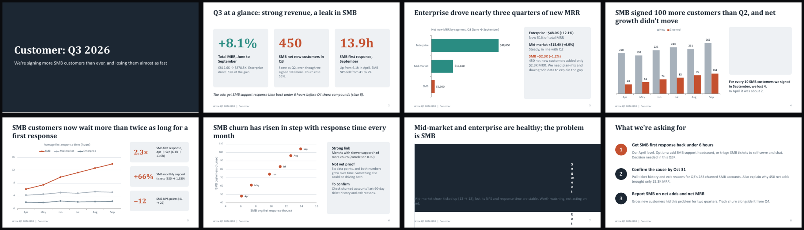
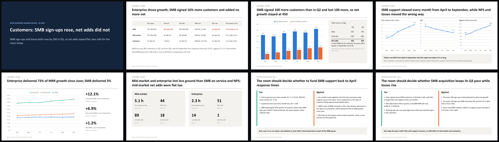
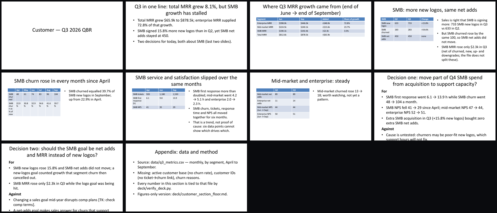

# Example 3 — Write the customer section of a quarterly business review (QBR) deck

**With the current version of the skill (v3.2), /ambitious won this one 3–0 with the blind judges. Both decks had 0 wrong numbers. What decided it was how they look when opened: 2 of plain Claude's 8 slides render broken in PowerPoint, while all 8 of v3.2's render cleanly, with 5 charts and no placeholders. v3.2 took about 2.4 times as long (24.8 minutes against 10.3) and cost about twice as much ($2.32 against $1.10). The earlier version, v3.1, lost this same comparison 0–3 by delivering a plain deck with blanks in it. The last section explains what changed.**

## The starting point

The project held two files and nothing else:

- [`notes.md`](../../evals/fixtures/acme-qbr/notes.md), three lines of meeting prep:
  > - Exec QBR is Thursday. I own the "Customer" section (~8 slides).
  > - Last quarter's deck was mostly charts of MRR by segment. Nobody remembered it a week later.
  > - Sales says SMB is "fine, we're adding more logos than ever".
- [`data/q3_metrics.csv`](../../evals/fixtures/acme-qbr/data/q3_metrics.csv), a spreadsheet-style text file with 18 rows: one per month (April to September 2026) for each of three customer groups, with new customers, lost customers, monthly revenue, satisfaction score, support tickets and support reply time.

**Words used on this page:**

- **/ambitious** (also "the skill"): a Claude Code skill, a packaged set of instructions you call by typing `/ambitious` before a task. It first prints a one-screen plan called a **card**, then does the work.
- **v3.2 and v3.1**: versions of the skill. v3.2 is the current one. v3.1 is the earlier version, which lost this test (see the last section).
- **Plain Claude**: the same model given the same request without the skill.
- **Rung** and **floor**: the card stacks more ambitious versions of the task like rungs on a ladder. The bottom one, the **floor** (rung 0), is exactly what you asked for, done properly. Each rung above it aims higher, and the card marks one as recommended.
- **Judge** (on the card): the check the skill commits to before starting work, so that the result is judged by something other than the model rereading its own work. Not to be confused with the **blind judges**, three separate model runs that compared the two finished decks afterwards.
- **Render**: draw a file the way it will actually appear on screen. A .pptx file is a set of instructions, and a slide can look fine in those instructions yet come out broken when PowerPoint draws it.
- **Placeholder**: a marker for text still to come, such as `TODO` or `[TK]` (a writer's mark for "to come"), left for someone to fill in before presenting.
- **QBR** (quarterly business review): a meeting where executives review the last three months. Q2 is April–June, Q3 is July–September.
- **MRR** (monthly recurring revenue): what customers pay per month on subscriptions.
- **SMB, mid-market, enterprise**: small, medium and large customers.
- **Logos**: sales slang for customer accounts; "new logos" are newly signed customers.
- **Churn**: customers who cancel. In Q3, 283 SMB customers churned. A **churn rate** would divide that by the total number of customers, which this data doesn't have.
- **Net adds**: new customers minus churned customers, so the real change in customer count.
- **NPS** (Net Promoter Score): a satisfaction survey score; higher is better.
- **First response time**: how many hours, on average, a customer waits for the first support reply.
- **Deck**: a set of presentation slides. A **.pptx** file is a PowerPoint deck. **Speaker notes** are text under each slide that only the presenter sees.

**What the data hides.** Sales is right that SMB signed more customers: 733 in Q3 against 633 in Q2. But SMB also lost 283 against 183, so net adds were 450 in both quarters. Over the same months, SMB first response time went from 6.1 hours (April) to 13.9 (September) and SMB NPS fell from 41 to 29. Total MRR grew 8.1% from June to September ($812.6k to $878.5k), mostly from enterprise (72.8% of the growth); SMB added only $2.3k. A good deck should find that story without being told.

**The request** was one line: make the customer section of the Q3 QBR deck. It named no format, no slide count and no audience. The notes supply the slide count (about 8) and the audience (executives); the format had to be guessed.

## What was typed

Plain Claude:

```text
make the customer section of our Q3 QBR deck
```

With the skill:

```text
/ambitious --go make the customer section of our Q3 QBR deck
```

`--go` tells the skill not to wait for a reply: it prints its plan card, takes the option it recommends, and does the work with no human in the loop. Both runs used the same model on fresh copies of the same two files ([how the comparison was run](../../evals/outcomes/OUTCOMES.md)). The v3.1 run described at the end used the same command, and was compared against the same plain Claude run.

## The two decks

Here is every slide of both decks. Each image shows 8 slides, read left to right, top row first.



*Plain Claude's deck, rendered by Microsoft PowerPoint. Slide 4 (top row, right) shows an empty grey box where its Q2/Q3 table should be. Slide 7 (bottom row, third) is a dark block with "Segment" spelled down the slide one letter per line.*



*The /ambitious v3.2 deck, rendered by Microsoft PowerPoint. All 8 slides are readable. Slides 3, 4 and 5 hold its 5 charts; slides 7 and 8 are the two decisions for the room.*

Plain Claude's working slides have the bolder design, and one judge said its "design looks more finished". But its two broken slides include the one that answers the Sales claim head-on.

## Without /ambitious

Plain Claude read the notes and the CSV, found the story that SMB net adds were flat, and built one PowerPoint file: [`q3_qbr_customer_section.pptx`](without/files/deck/q3_qbr_customer_section.pptx), 8 slides with 4 native charts (charts you can edit inside PowerPoint), two tables, its own colours and speaker notes on every slide. Its text is extracted in [`q3_qbr_customer_section.slides.md`](without/files/deck/q3_qbr_customer_section.slides.md). The run took 10.3 minutes (618.1 seconds) and cost $1.10 ([`timing.json`](../../evals/outcomes/results/acme-qbr/without_skill/timing.json)).

The deck makes a single argument aimed at the Sales claim. Slide 1, under the title "Customer: Q3 2026", reads:

```text
We're signing more SMB customers than ever, and losing them almost as fast
```

Slide 6 shows that SMB churn and response time rose together, and labels this "Not yet proof". But the speaker notes on slide 8, the ask slide, lean on cause anyway:

```text
If the churn link holds, every month at 14-hour response costs us roughly 100 SMB customers.
```

It ended on three asks (cut SMB response time below 6 hours, confirm the cause by Oct 31, report SMB on net adds). Its final reply said plainly that these were its own proposals ([`response.md`](without/response.md)):

> - **The asks on slide 8 are my proposal**, including the 6-hour target (your April level), the Oct 31 date and the staffing options. Change them to fit what you can actually commit to.

The same reply opened with a warning that turned out to matter:

> **I haven't seen it rendered yet.** LibreOffice is missing from this Mac and pip couldn't download the official validator's packages. I only checked that the file structure is valid, so open it in PowerPoint before Thursday and look for text that overflows or overlaps.

It wrote no script to check its numbers.

## With /ambitious v3.2

The skill first read the two files without changing anything. Then, before building anything, it printed a short summary, its card and a reusable prompt. All of it is in [`with/card.md`](with/card.md), copied verbatim from the run:

> The SMB segment isn't fine. Sign-ups hit a record, but customers leaving grew faster, so SMB's net gain stayed at exactly 450 in both quarters while support reply times more than doubled. Rung 2 turns the section into two decisions for the room, each argued both ways, with every number checked by a script against your data.

```text
── /ambitious ──────────────────────────────────────────────────────
asked    Q3 QBR customer section, ~8 slides (as .pptx, inferred)
found    SMB net adds flat: +450 in Q2, +450 in Q3 (q3_metrics.csv)
doubt    "SMB is fine, more logos" → new +16% but churned +55%
stakes   SMB reply 6.1→13.9 h, NPS 41→29; last deck forgotten

  2 │    the 2 calls the room must make, each argued both ways     ◀
  1 │    why Q3 moved: SMB losses track support slowdown + actions
  0 ┷    floor: 8 slides, every figure recomputed from the CSV

deeper   monthly rows not averages; logo bridge new→churned→net
wider    finance: logo bridge · ops: queue load · skeptic: causation
target   0 deck figures off the CSV; both calls decided Thursday
judge    check_figures.py rederives every number, tier 1; rubric
         proxy (fresh subagent), tier 4; the meeting itself, tier 2
access   ✓ python3 python-pptx soffice · ✗ customer base, exit reasons
cost     floor ~25 min · rung 2 ~45 min, ~3× tokens · you ~15 min
── reply: go (rung 2) · go 1 · go 0 (floor only) ───────────────────
```

**What the card is saying, line by line:**

- **asked**: its reading of the request. "~8 slides" comes from the notes. "as .pptx, inferred" means it guessed the format, a PowerPoint file, and flags the guess so you can correct it.
- **found**: the fact from the CSV that changes the job: SMB's net gain was +450 in both quarters.
- **doubt**: a belief from the notes, tested against the data. The card shortens Sales' "fine, we're adding more logos than ever" to "SMB is fine, more logos". New SMB customers did rise 16% (633 to 733), but customers lost rose 55% (183 to 283).
- **stakes**: the cost of not looking. SMB's first support reply slowed from 6.1 to 13.9 hours and NPS fell from 41 to 29, and the notes say last quarter's deck was forgotten.
- **rung 2 ◀** (recommended): build the section around the two decisions ("calls") the executives must make, each argued for and against.
- **rung 1**: explain why Q3 moved: SMB losses rose along with the support slowdown, ending in actions.
- **floor (0)**: what was asked, done properly: 8 slides, every figure recomputed from the CSV. The floor is delivered whatever happens above it, and under v3.2 it also has to look finished (see the last section).
- **deeper**: what a top analyst would do: work from the monthly rows rather than averages, and show a "logo bridge", a small table that walks from new customers, minus customers lost, to the net change. Slide 3 has one.
- **wider**: methods borrowed from other jobs: finance teams' bridge tables, operations teams' view of how loaded the support queue is, and a skeptic asking whether one thing really caused another.
- **target**: two goals: zero figures in the deck that don't match the CSV, and both decisions actually made at Thursday's meeting.
- **judge**: how success is checked, decided before the work. The skill ranks checks in four tiers. `check_figures.py`, a script it would write to recompute every number, is tier 1, the strongest: a program that runs and returns a number. The "rubric proxy" is tier 4, the weakest: a fresh AI helper (a subagent, a separate model run started by the main one) that sees only the deck and scores it against a scoring checklist written in advance. "The meeting itself" is tier 2, a real-world result with a date: whether the room decides on Thursday.
- **access**: what the skill believed this session could use (✓) and what was missing (✗). The card marks Python, python-pptx (a code library that writes PowerPoint files, including real charts) and soffice (LibreOffice's command-line program, which can turn slides into a PDF) as available; how rendering actually went is covered under "Did it look at the slides?" below. Total customers per group and the reasons customers gave for leaving were not in the data.
- **cost**: its estimate: about 25 minutes for the floor alone, about 45 minutes for rung 2 using about 3 times as many tokens (the units AI usage is billed in), and about 15 minutes of your own review. The run actually took 24.8 minutes (1,485.6 seconds) and cost $2.32 ([`timing.json`](../../evals/outcomes/results/acme-qbr/with_skill/timing.json)), against 10.3 minutes and $1.10 for plain Claude.

Under the card it wrote a reusable prompt, a self-contained request you could paste into any AI tool:

```text
Build the Customer section (~8 slides, .pptx) of Acme's Q3 2026 QBR from data/q3_metrics.csv (monthly new, churned, MRR, NPS, tickets and first-response hours for smb, mid_market and enterprise, Apr–Sep). The headline is that SMB added a record 733 logos in Q3 (+16% vs Q2) but churned 283 (+55%), so net adds were flat at 450, while first response rose from 6.1 h to 13.9 h and NPS fell from 41 to 29. Sales believes SMB is "fine". Present that as a trend and not a proven cause, since there are only 6 months and no customer-base totals, so no churn rate. Structure the section around two decisions the execs must make, each argued for and against using only this data. Before building, write a script that independently recomputes every number in the deck text and chart data from the CSV, show that it fails on a planted wrong figure, and get it to report 0 mismatches. Deliver the plain, finished slides first, render them to PDF and check every page, and list anything you couldn't confirm, with numbers, instead of guessing.
```

Its last sentence carries the rules new in v3.2: finished slides first, render and check every page, and a list of what couldn't be confirmed instead of guesses. It then wrote "Taking rung 2 (`--go`)." and started work.

**What it delivered.** The run's full transcript isn't published, and [`response.md`](with/response.md) keeps only its final reply, so this part describes the files it left in a new `qbr/` folder:

- **The deck**, [`customer_section_q3.pptx`](with/files/qbr/customer_section_q3.pptx): 8 slides with speaker notes on every one.
  1. Title: "Customers: SMB sign-ups rose, net adds did not".
  2. A table of all three customer groups: new, churned, net adds, MRR, NPS and first response.
  3. SMB new and lost customers by month (a chart) beside the Q2-to-Q3 logo bridge.
  4. SMB first response time, NPS and support tickets, as three small charts side by side.
  5. MRR by customer group (a chart), with each group's growth since June.
  6. Mid-market and enterprise in figures.
  7. and 8. The two decisions, each with For, Against and an ask.
- **The builder**, [`build_customer_section.py`](with/files/qbr/build_customer_section.py): a 390-line script that reads the CSV and writes the deck with python-pptx, so the deck can be rebuilt if the data changes.
- **The check**, [`check_figures.py`](with/files/qbr/check_figures.py): a 134-line script. Every number in the slide text, tables and speaker notes must equal, at the precision shown, a value computed straight from the CSV (a raw cell, a quarter total, a difference, a percentage change, a ratio or a "per 100" figure). Every chart series must equal a CSV column exactly. Its last reported result was 117 numbers checked, 0 mismatches.
- **The to-confirm note**, [`TO_CONFIRM.md`](with/files/qbr/TO_CONFIRM.md): four things the data couldn't settle: total customers per group, SMB exit reasons, support cost, and whether there's a house deck template.

The scripts and the note sit beside the deck, not inside it. Every slide after the title cites only the data file: "Source: data/q3_metrics.csv (monthly, Apr–Sep)".

One of its two decision slides, as delivered (text extracted from the .pptx):

```text
DECISION FOR THE ROOM · CALL 1
The room should decide whether to fund SMB support back to April response times

For
•  First response rose every month, 6.1 h → 13.9 h. NPS fell every month, 41 → 29.
•  Customers lost rose every month too, 48 → 104.
•  SMB tickets grew 36% quarter on quarter, faster than SMB sign-ups (+16%). If that continues, the queue grows unless capacity does.

Against
•  Six months move together, but that does not prove slow support causes the losses. Price, product fit or the type of customer being signed could explain them.
•  SMB is 22% of MRR and grew 1.2% in Q3. Money spent here is not spent on enterprise, which delivered 73% of MRR growth since June.
•  We have no exit reasons and no total customer count, so we cannot size the payoff yet.

Ask: a yes or no, an owner, and whether to start with a time-boxed test on part of the SMB queue.

Source: data/q3_metrics.csv (monthly, Apr–Sep)
```

Neither starting file names an owner, a deadline or a support cost. Instead of leaving blanks, the slide asks the room for an owner and says the payoff can't be sized yet. The gap goes in the to-confirm note:

> - **Support cost.** Call 1 asks for funding, but no cost figure is in the data, so the slide doesn't size the ask. Add one if support can provide it.

**Did it look at the slides?** Only partly. v3.2 tells the skill to render the deck and look at every page, and the final reply says the last attempt failed:

> The Quick Look preview of the title slide also failed: it hit the background time limit and was stopped. I'm not trying again, since that's the third way of rendering the deck that hasn't worked. So the last round of wording edits still hasn't been looked at as slides. Open `qbr/customer_section_q3.pptx` and skim the slide 1 and slide 6–8 titles before Thursday. The figure check still passes (117 numbers, 0 mismatches).

The PowerPoint render at the top of this page shows those titles fit.

## What the hidden checks found

After both runs finished, an independent tester (a separate model run whose checks neither run saw) pulled every number out of both decks, including tables, speaker notes and chart data, and recomputed each one from the CSV. It also looked at every rendered slide and searched both files for placeholders. Source: [`measurements-and-judgments.json`](../../evals/outcomes/results/measurements-and-judgments.json).

| Measure | Plain Claude | /ambitious v3.2 |
|---|---|---|
| Deck delivered | 8 slides, 4 charts, notes on every slide | 8 slides, 5 charts, notes on every slide; plus a build script, a check script and a to-confirm note in separate files |
| Numbers that refer to data, checked | 91 (65 on slides, 26 in notes) | 104 (all on slides) |
| Wrong numbers | **0** | **0** |
| Numbers that couldn't be traced to the CSV | 0 | 0 |
| Chart values matching the CSV | 45 of 45 | 48 of 48 |
| Slides broken when rendered | **2** (slides 4 and 7) | **0** |
| On-slide numbers unreadable when rendered | 27 of 65 | 0 |
| Visible placeholders (`[TK]`, `TODO` and similar) | 0 | 0 |
| Overclaims cause and effect | partly | no |
| Ends in decisions for the executives | 3 asks with a deadline; no owner or cost | 2 decisions, each for and against, with options; no deadline or cost |
| Ships a re-runnable number check | no | yes: 117 numbers and 5 charts, 0 mismatches |
| Run time and cost | 10.3 min, $1.10 | 24.8 min, $2.32 |

What the numbers mean:

- **Wrong numbers.** A figure counts as correct if recomputing it from the CSV and rounding to the precision shown gives the same value. Neither deck had a wrong one. One of plain Claude's is borderline: it gives the correlation (how closely two numbers rise and fall together) between SMB response time and churn as 0.99, when the real value, 0.9966, rounds to 1.00. The two counts of v3.2's numbers differ (104 and 117) because the tester and the skill's script count differently: the tester left out labels that the script counts, such as the 3 in the data file's name (`q3_metrics.csv`), the 1 in "CALL 1" and the 100 in "per 100 sign-ups".
- **The broken slides are a fault in plain Claude's file, not in PowerPoint.** The tables on slides 4 and 7 set the space inside each cell to 4 inches and 8 inches on each side, in columns only 0.6 to 1.8 inches wide. PowerPoint has no room left for the text, so slide 4's Q2/Q3 table (633/733, 183/283, 450/450) comes out as an empty box and slide 7's comparison of all three groups as an unreadable dark block. That makes 27 of its 65 on-slide numbers impossible to read. Plain Claude had said it never saw the deck rendered.
- **v3.2's visual flaws are small.** On slide 4 the chart captions overlap the top labels of the axes; one data label reads "1530" while its axis uses "1,600"; the slide 4 title mentions losses, which aren't charted on that slide; on slide 3 the note sits tight under the "Net adds" row; and slide 2's percentage changes don't say they run from June to September.
- **Overclaiming cause.** Plain Claude's slide 6 is properly hedged, but elsewhere the deck leans on cause. "Losing them almost as fast" overstates it: SMB lost 283 against 733 signed in Q3 (38.6%). The "roughly 100 SMB customers" a month blames all of September's 104 lost customers on slow support, but April already lost 48 at 6.1 hours, so the extra is about 56. It also calls "under 6 hours" "Our April level", but April was 6.1 hours. v3.2 calls the link "a pattern, not proof", and because the data has no total customer count, it shows "losses per 100 sign-ups" and labels them "not a churn rate".
- **Decisions.** Plain Claude's asks are concrete and dated, though the Oct 31 date is its own proposal. v3.2 sets out two decisions with options to choose from, but its own recommendation, a time-boxed test, appears only in the speaker notes.
- **Insights only one deck had.** Only plain Claude pointed out that 450 net new SMB customers added just $2.3k of MRR. Only v3.2 pointed out that mid-market net adds were flat too (89 in both quarters) and that SMB support tickets grew 36% against 16% more sign-ups.

## What the blind judges said

Three model judges each received both finished projects, labelled only A and B, with the skill's files removed, so they could not tell which run used the skill. Here plain Claude was A. Each judged through a different lens, meaning a point of view: a busy requester, a senior practitioner and a skeptic. Confidence is each judge's own stated certainty, on a scale where 1.0 means certain.

This time the judges also had images of every slide as PowerPoint renders them. All three saw plain Claude's two broken slides, and all three opened the file itself to confirm the fault was in the deck, not the renderer.

| Lens | Winner | Confidence |
|---|---|---|
| Busy requester | /ambitious v3.2 | 0.8 |
| Senior practitioner | /ambitious v3.2 | 0.85 |
| Skeptic | /ambitious v3.2 | 0.85 |

- **Busy requester:** found plain Claude's story "a bit sharper", with a clear three-part ask and good speaker notes, and v3.2's decision slides "slightly less punchy". But counting fix-up time: "B can ship today with almost no work. A needs table surgery first."
- **Senior practitioner:** credited plain Claude with the more finished design, a clear and honestly caveated chart of churn against response time, a clear ask and the $2.3k point that v3.2 missed. Faulted v3.2 for plain styling, text-heavy decision slides and no recommendation on the slide itself. Still: "a deck with two visibly broken core slides is not ready for an exec QBR".
- **Skeptic:** recomputed the key figures, ran v3.2's `check_figures.py` (it passed: 117 numbers and 5 charts, 0 mismatches) and rebuilt the deck from its build script in a scratch copy, which also passed. It called the extra scripts and note "a little beyond the request" but said they back the deck's accuracy, and concluded: "B is the result I'd trust without re-checking."

## Earlier version (v3.1) — and why it lost

Before v3.2, this test was run with v3.1 of the skill: the same command, the same starting files, and the same plain Claude deck shown above. v3.1 lost 0–3.



*The /ambitious v3.1 main deck (10 slides), rendered by Microsoft PowerPoint: the converter's default look, tables and bullets, no charts. The two decision slides (second row, right, and third row, left) run off the bottom of the slide, and the second still shows "[TK: check comp terms]".*

**What v3.1 did.** Its plan was close to v3.2's: the same story, the same recommended rung (two decisions argued both ways) and a script to tie every figure to the CSV. It wrote that check first, [`verify_deck.py`](with-v3.1/files/deck/verify_deck.py), proved it could fail by feeding it planted wrong figures and 200 random numbers, and made it stricter three times before writing any slide, raising its catch rate on the random numbers from 52% to 96.5%. Then it wrote a 9-slide figures-only floor deck and a 10-slide main deck as Markdown (plain text with simple formatting marks), had a fresh helper score the decision slides (10/12, then 11/12 after fixes), and converted both decks to PowerPoint with pandoc, a document converter, using its default template. It took 5.9 minutes (354.2 seconds) and cost $1.49 ([`timing.json`](../../evals/outcomes/results-v3.1/acme-qbr/with_skill/timing.json)). Its final reply, with its result card, is in [`with-v3.1/response.md`](with-v3.1/response.md).

**What it got right.** The tester found 0 wrong numbers among the 84 in the main deck and 0 among the 62 in the floor deck. It was careful about cause and claimed no churn rate. Its own script reported 146 of 146 figures traced across both decks.

**What it got wrong.**

- **It looked unfinished.** The converter's default template, no charts, and a 7-column table squeezed into half a slide.
- **It left blanks on the slides.** Both decision slides ended with "**Owner / decide by:** [TK: owner] / [TK: date]", and one also had "[TK: check comp terms]". Its reply explained: "I didn't fill these in because none of the files say who owns these decisions."
- **It put its scaffolding in front of executives.** It shipped two decks, two Markdown sources and the check script, and its last slide, an appendix, pointed executives at `deck/verify_deck.py`. It ran to 10 slides against the notes' "~8".
- **It never looked at its slides.** The decision slides run off the bottom of the page.
- **Its check had a blind spot.** The tester planted 10 errors in copies of the deck. The script caught 5 of 5 arithmetic typos (450 changed to 451, say) but missed 5 of 5 swaps where a real number from the wrong month or group was used (September's 13.9 hours changed to August's 12.6). It also checked the Markdown source, not the .pptx file.

**The blind judges** ([`results-v3.1/measurements-and-judgments.json`](../../evals/outcomes/results-v3.1/measurements-and-judgments.json)) all preferred plain Claude:

| Lens | Winner | Confidence |
|---|---|---|
| Busy requester | plain Claude | 0.8 |
| Senior practitioner | plain Claude | 0.72 |
| Skeptic | plain Claude | 0.6 |

- **Busy requester:** plain Claude's deck needed about 10–15 minutes of wording fixes, while v3.1's needed an hour or more: default styling, no charts, the squeezed table, overflowing decision slides, `[TK]` gaps, and an appendix pointing executives at project files.
- **Senior practitioner:** both found the same story and got the numbers right, and v3.1's analysis was slightly more balanced, but plain Claude's deck was "far better made" and more likely to be remembered.
- **Skeptic:** v3.1 over-built (two decks, two Markdown sources and a 129-line script in the user's project), assumed a "logo goal" that no file mentions, and probably overflowed its slides; plain Claude's flaws were a few overstatements and an invented Oct 31 deadline.

**A caveat about that verdict.** Plain Claude's deck was the same file in both rounds, broken tables included. The v3.1-round judges didn't have PowerPoint's renders: one used the Mac's Quick Look preview and another wrote "I could not render the files". None of them mentioned the broken tables, and two listed plain Claude's segment table among its strengths. So part of the swing from 0–3 to 3–0 comes from the judges seeing plain Claude's deck as PowerPoint draws it, not only from v3.2's better deck.

**The human review.** Separately, a human reviewer, the skill's author, looked at the v3.1 deck and said it looked worse than plain Claude's. Blind judges had also preferred plain Claude's [launch post](../04-launch-post/) 2–1 over v3.1's, which likewise left `[TK]` blanks (v3.2 still loses that post 2–1). The diagnosis: v3.1 traded polish for verification. It checked every number but delivered something that looked unfinished, and a deck that looks worse won't get used, however correct it is.

**What changed in v3.2.** Two of the skill's build steps were rewritten and a third was added ([`SKILL.md`](../../skills/ambitious/SKILL.md)), bringing four new requirements, each aimed at one of v3.1's failures:

| v3.1's failure | The v3.2 rule (quoted from the skill) | What the v3.2 run did |
|---|---|---|
| Default template, no charts | "Deliver exactly what was asked, at least as polished as you would make it without this skill", using "real charts where the data has a trend" | Built the deck with python-pptx: 8 slides, 5 charts, speaker notes throughout |
| `[TK]` blanks for owners, dates and comp terms | "No `[TK]` markers, `TODO`s or bracketed blanks inside the deliverable"; write around a missing fact and list it in a "to confirm" note | 0 placeholders; the slides ask the room for an owner; `TO_CONFIRM.md` lists 4 gaps |
| Floor deck, Markdown sources and an appendix about the check script, all handed over as the deliverable | "Keep judge scripts, floor copies and other scaffolding out of the deliverable" | One deck; the build and check scripts sit in separate files; the slides cite only the data file |
| Overflowing slides nobody looked at | "render it the way the user will see it, for example as a PDF or images, and look at every page" | 0 broken or overflowing slides in the PowerPoint render, though by its own account the last round of edits wasn't looked at as slides |

The reason the skill now gives for the first rule: "Depth goes on top of a finished floor, never instead of one, because a result that looks worse won't get used, however correct it is."

The fix has a price. On this task v3.2 took 24.8 minutes and cost $2.32, against 5.9 minutes and $1.49 for v3.1.

## Takeaway

With v3.2, this example flipped from a 0–3 loss to a 3–0 win. All three decks got every number right; what decided it was whether the deck could be shown on Thursday. Plain Claude's deck has the bolder design and, in two judges' view, the sharper story, but two of its key slides are broken and it never saw them rendered. v3.2's deck is plainer but renders cleanly, has charts where the data trends, leaves no blanks, and comes with a script that recomputes every figure. It took about 2.4 times as long and cost about twice as much as plain Claude, and its last round of edits went unchecked as rendered slides. Part of the swing also comes from the judges seeing PowerPoint renders this time. This is one run per version, judged by models rather than people. The lesson v3.1 taught is now in the skill: checking the numbers only helps if what you deliver is finished enough to use.

## Files

From the /ambitious v3.2 run ([`./with`](with/)):

- [`with/prompt.txt`](with/prompt.txt): what was typed
- [`with/card.md`](with/card.md): the summary, card and reusable prompt it printed before any work, verbatim
- [`with/response.md`](with/response.md): its final reply only
- [`with/files/qbr/customer_section_q3.pptx`](with/files/qbr/customer_section_q3.pptx): the 8-slide deck
- [`with/files/qbr/TO_CONFIRM.md`](with/files/qbr/TO_CONFIRM.md): what the data couldn't confirm
- [`with/files/qbr/check_figures.py`](with/files/qbr/check_figures.py) and [`with/files/qbr/build_customer_section.py`](with/files/qbr/build_customer_section.py): the figure check and the deck builder. Both need the python-pptx library and look for `data/q3_metrics.csv` one folder above `qbr/`, so run them inside a copy of the [starting project](../../evals/fixtures/acme-qbr/).
- [`with/rendered-slides.png`](with/rendered-slides.png): the deck as Microsoft PowerPoint renders it

From the plain Claude run ([`./without`](without/)):

- [`without/prompt.txt`](without/prompt.txt) and [`without/response.md`](without/response.md)
- [`without/files/deck/q3_qbr_customer_section.pptx`](without/files/deck/q3_qbr_customer_section.pptx): the 8-slide deck with charts
- [`without/files/deck/q3_qbr_customer_section.slides.md`](without/files/deck/q3_qbr_customer_section.slides.md): its text, extracted
- [`without/rendered-slides.png`](without/rendered-slides.png): the deck as Microsoft PowerPoint renders it

From the earlier /ambitious v3.1 run ([`./with-v3.1`](with-v3.1/)):

- [`with-v3.1/prompt.txt`](with-v3.1/prompt.txt) and [`with-v3.1/response.md`](with-v3.1/response.md) (final reply, with its result card)
- [`with-v3.1/files/deck/customer_section.md`](with-v3.1/files/deck/customer_section.md) and [`.pptx`](with-v3.1/files/deck/customer_section.pptx): the 10-slide main deck
- [`with-v3.1/files/deck/customer_section_floor.md`](with-v3.1/files/deck/customer_section_floor.md) and [`.pptx`](with-v3.1/files/deck/customer_section_floor.pptx): the 9-slide figures-only floor deck
- [`with-v3.1/files/deck/verify_deck.py`](with-v3.1/files/deck/verify_deck.py): its check script
- [`with-v3.1/rendered-slides.png`](with-v3.1/rendered-slides.png): the main deck as Microsoft PowerPoint renders it

Raw eval data:

- [`../../evals/outcomes/results/acme-qbr/with_skill/`](../../evals/outcomes/results/acme-qbr/with_skill/) (v3.2): `prompt.txt` (what was typed), `response.md` (the final reply), `diff.patch` and `diffstat.txt` (every change the run made to the project, in full and as a summary), `timing.json` (time, tokens and cost)
- [`../../evals/outcomes/results/acme-qbr/without_skill/`](../../evals/outcomes/results/acme-qbr/without_skill/) (plain Claude, compared against both versions): the same five files
- [`../../evals/outcomes/results-v3.1/acme-qbr/with_skill/`](../../evals/outcomes/results-v3.1/acme-qbr/with_skill/) (v3.1): the same five files
- [`../../evals/outcomes/results/measurements-and-judgments.json`](../../evals/outcomes/results/measurements-and-judgments.json) and [`../../evals/outcomes/results-v3.1/measurements-and-judgments.json`](../../evals/outcomes/results-v3.1/measurements-and-judgments.json): every measurement and the judge verdicts for each round, with the A/B labels mapped back to plain Claude and /ambitious
- [`../../evals/outcomes/results/summary.json`](../../evals/outcomes/results/summary.json): time, cost and verdicts for all four v3.2 comparisons
- [`../../evals/outcomes/OUTCOMES.md`](../../evals/outcomes/OUTCOMES.md) and [`../../evals/outcomes/run_outcomes.sh`](../../evals/outcomes/run_outcomes.sh): how the comparison was run
- [`../../evals/fixtures/acme-qbr/`](../../evals/fixtures/acme-qbr/): the starting project
- [`../../skills/ambitious/SKILL.md`](../../skills/ambitious/SKILL.md): the skill itself
